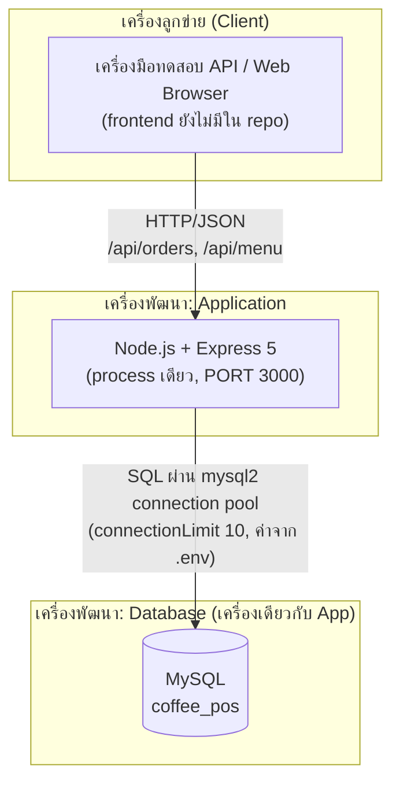
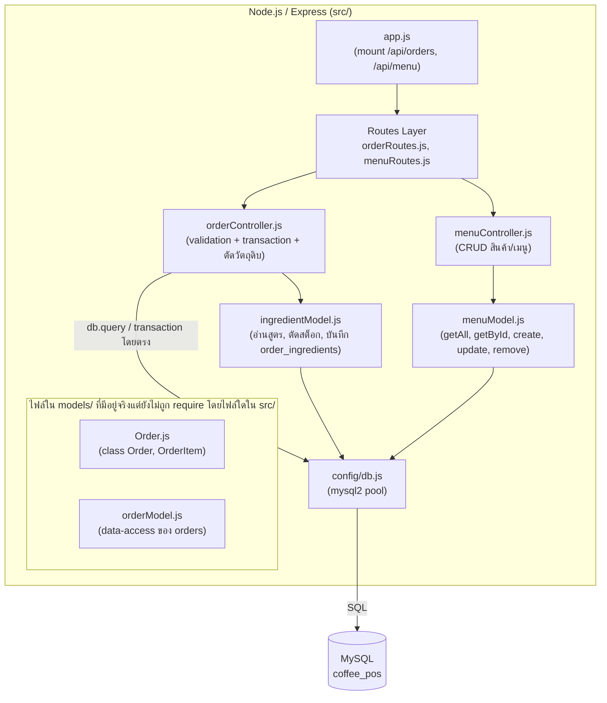

# wk11-architecture.md — สถาปัตยกรรมระบบ Cafe POS (กลุ่ม WeLoveCookierun)

อ้างอิงโครงสร้าง repository จริง `cafe-pos-group-WeLoveCookierun` (ตรวจจากคำสั่ง `require()` ของแต่ละไฟล์ใน `src/`) และเอกสารของกลุ่มจากสัปดาห์ก่อนหน้า

## 0. ความสอดคล้องกับ 4+1 View Model

| View | เอกสารของกลุ่ม | สถานะ |
| --- | --- | --- |
| Scenarios | `use case diagram wk04.png` (สัปดาห์ 4) | มีแล้ว |
| Logical View | `wk06-class-diagram.png`, `wk06-object-diagram.png` (สัปดาห์ 6) | มีแล้ว |
| Process View | `wk09-sequence-diagram.png` (flow สร้างออเดอร์ + ตัดวัตถุดิบ) | มีแล้ว |
| Development View | หัวข้อ 2 ของเอกสารนี้ | ทำสัปดาห์นี้ |
| Physical View | หัวข้อ 1 ของเอกสารนี้ | ทำสัปดาห์นี้ |

---

## 1. Physical View (Deployment topology จริง)

ปัจจุบันระบบรันบนเครื่องพัฒนาเครื่องเดียว: Node.js server (พอร์ต 3000 ตามค่าเริ่มต้นใน `app.js`) และ MySQL (ฐานข้อมูล `coffee_pos` จาก `wk07-schema.sql`) ยังไม่ได้ deploy ขึ้น cloud และ repo ยังไม่มีโค้ดหน้าจอ (frontend) — wireframe สัปดาห์ 10 ยังอยู่ในเอกสาร ไคลเอนต์ที่เรียก API จริงตอนนี้จึงเป็นเครื่องมือทดสอบ API/เบราว์เซอร์

หมายเหตุ: มี Database Server เพียงเครื่องเดียว ไม่มี load balancer และไม่มีเซิร์ฟเวอร์แยกตามสาขา

---

## 2. Development View (การแบ่ง component/module ตามโค้ดจริง)

โฟลเดอร์ `src/models/` ของกลุ่มมีไฟล์ครบทั้งสองชนิดที่ wk11.md กล่าวถึง แต่การเรียกใช้จริงเป็นแบบผสม จึงไม่ตรงกับเวอร์ชัน (ก) หรือ (ข) ของตัวอย่างเป๊ะ ๆ diagram ด้านล่างวาดตามที่โค้ดเรียกกันจริง:

**ความสอดคล้องกับ repo (ตรวจแล้ว):**
- `orderController.js` เรียก `db.query`/transaction ผ่าน `config/db.js` โดยตรงสำหรับตาราง `orders`, `order_items`, `payments`, `products` และเรียก `ingredientModel.js` เฉพาะส่วนวัตถุดิบ
- `menuController.js` ไปผ่าน `menuModel.js` เสมอ
- `Order.js` (domain class ตามข้อบังคับ wk06) และ `orderModel.js` มีอยู่จริงใน `src/models/` แต่ยังไม่มีไฟล์ใด `require` จึงวาดแยกกลุ่มไว้ ไม่วาดลูกศรเชื่อมให้ดูเหมือนถูกใช้งานแล้ว

---

## 3. สรุปสถาปัตยกรรม

ระบบของกลุ่มเป็น **Monolithic + Layered**: deploy เป็น Node.js process เดียว (พอร์ต 3000) ต่อกับ MySQL ฐานข้อมูลเดียว (`coffee_pos`) และแบ่งชั้นภายใน repo เป็น routes → controllers → models → config/db ตามที่วางไว้ตั้งแต่สัปดาห์ 5 เหตุผลที่ไม่แยกเป็น service คือทีมมี 5 คน ระยะเวลาสั้น และขอบเขตยังอยู่ใน 4 ส่วนหลัก (เมนู, POS, สต็อกวัตถุดิบ, รายงาน) การแยก service จะเพิ่มความซับซ้อนโดยไม่จำเป็น

**ข้อจำกัดของโค้ดปัจจุบัน (ระบุตามจริง ไม่วาดให้ดูสมบูรณ์เกินจริง):**
1. `createOrder` ครอบด้วย database transaction แล้ว (BEGIN/COMMIT/ROLLBACK) แต่การอ่านปริมาณวัตถุดิบก่อนตัดสต็อกยังไม่ล็อกแถว (ไม่มี `SELECT ... FOR UPDATE`) หากมีสองออเดอร์เข้าพร้อมกันอาจตัดสต็อกเกินจริงได้
2. การแจ้งเตือนวัตถุดิบใกล้หมดตอนนี้บันทึกลง console log เท่านั้น ยังไม่ได้ส่งถึงผู้จัดการร้าน
3. ยังไม่มีชั้น Presentation (frontend) ใน repo และยังไม่มีระบบยืนยันตัวตน (authentication) บน API
4. `Order.js` และ `orderModel.js` ยังไม่ถูกเรียกใช้ ควรเลือกว่าจะนำมาใช้ใน `orderController.js` หรือจะลบออกในสัปดาห์ถัดไป
5. wireframe สัปดาห์ 10 กำหนดให้ทุกหน้าจอมีตัวเลือกสาขา แต่ `wk07-schema.sql` ยังไม่มีคอนเซปต์สาขา (`branch_id`) ต้องตัดสินใจร่วมกันว่าจะเพิ่มใน schema หรือปรับ wireframe
