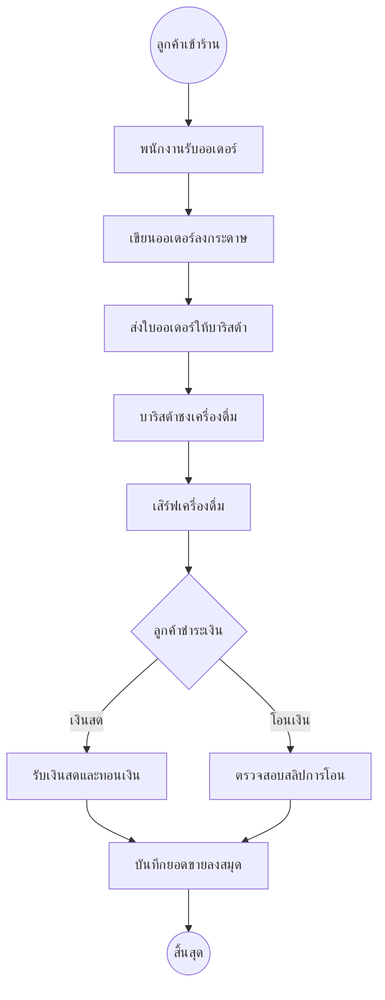
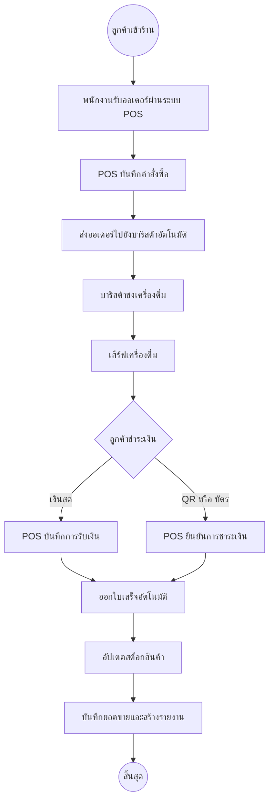

### หัวข้อที่ 1 รายงานความเป็นไปได้ของระบบร้านคาเฟ่

## Techinal Feasibility (ด้านเทคนิค)

- ทีมมีความสามารถและมีความรู้ใน tech stack ที่ใช้ เช่น react, node js, javascript และพื้นฐานของเว็บแอปลิเคชัน และสมาชิกในทีมมี notebook, pc ทุกคน

## Economic Feasibility (ด้านเศรษฐศาสตร์)

- เราจะพัฒนาระบบ POS ในการนำมาประยุกต์ใช้กับร้านเคเฟ่ เนื่องจากมีความสะดวกสบาย และต้นทุนการพัฒนาระบบนี้มีการรองรับค่าใช้จ่ายที่เพียงพอ

## Operational Feasibility (ด้านการดำเนินงาน)

- คาดว่าพนักงานและบุคคลที่ใช้ระบบ POS จะต้องถูกอบรมการใช้งานให้ไม่เกิดข้อผิดพลาด และสามารถปรับตัว ทำให้ใช้งานได้อย่างถูกต้อง

## Schedule Feasibility (ด้านระยะเวลา)

- ระบบนี้สามารถพัฒนาตามกำหนดการอย่างแน่นอน โดยมีการจัดวางตารางเวลาเอาไว้เรียบร้อย

### หัวข้อที่ 2 BPMN diagram As-IS

### หัวข้อที่ 3 BPMN diagram To-Be

### หัวข้อที่ 4 BPMN แบบ To-Be ช่วยแก้ปัญหาที่ระบุใน Operational และ Economic Feasibility อย่างไร

-ช่วยให้เห็นภาพง่ายขึ้นในเรื่องของกระบวนการ วิธีการและผลลัพธ์ ลดความผิดพลาด ลดเวลา จะได้มีการวางแผนได้ถูกต้อง
